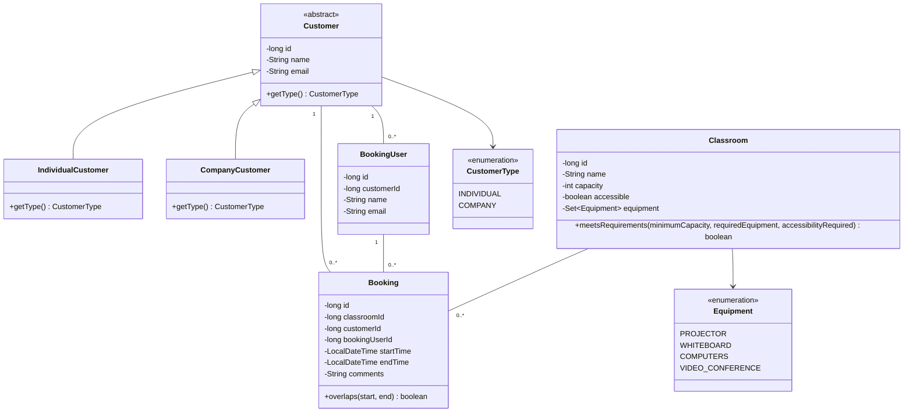

# Classroom Rental App

A Java SE console application for managing 20 training classrooms, customer registration, availability searching and reservations.

## Project status

The console application, domain models, JDBC DAOs and services are implemented. Final acceptance testing is pending local verification.

## Technology stack

Java 25 LTS, Maven, MySQL 8.4, native JDBC (MySQL Connector/J), JUnit 5, VS Code, Markdown and Mermaid, Git and GitHub.

## Documentation

- [Requirements and development plan](docs/REQUIREMENTS.md)
- [Architecture, UML and database design](docs/DESIGN.md)
- [Official assignment](https://github.com/Elnaz-Azizi/project-test-1/blob/main/ProjectTest_ClassRoomRentalApp.md)
- [Assessment guide](https://github.com/Elnaz-Azizi/project-test-1/blob/main/README.md)

## UML class diagram



The diagram shows domain relationships; the implementation references related records by ID. See the [design document](docs/DESIGN.md) for the database ER diagram and supporting classes.

## Setup (Windows PowerShell)

Install Java 25, Maven and MySQL 8.4. Verify the tools:

```powershell
java -version
mvn -version
mysql --version
```

From the repository root, open the MySQL client with a database administrator account:

```powershell
mysql -u root -p
```

Run these commands at the MySQL prompt, adjusting the absolute paths if the repository is stored elsewhere:

```sql
SOURCE E:/Projects/classroom-rental-app/sql/schema.sql;
USE classroom_rental;
SHOW TABLES;
```

Verify that schema.sql reports no errors and all five tables exist before proceeding.

```sql
SOURCE E:/Projects/classroom-rental-app/sql/seed.sql;
SELECT COUNT(*) AS classroom_count FROM classrooms;
```

Run seed.sql **only once on a fresh database**. If a setup attempt fails, do not rerun the seed against partially populated tables. Inspect the existing data first; reset the project database only if it contains no data you need to keep. Expected classroom count: 20. The sample customers and booking users are fictional.

For local development, create a dedicated account once and grant only the application's CRUD permissions. MySQL prints the randomly generated password; store it privately.

```sql
CREATE USER 'classroom_app'@'localhost' IDENTIFIED BY RANDOM PASSWORD;
GRANT SELECT, INSERT, UPDATE, DELETE ON classroom_rental.* TO 'classroom_app'@'localhost';
EXIT;
```

Back in PowerShell, configure the current terminal session. Enter the generated password at the masked prompt.

```powershell
$env:DB_URL = 'jdbc:mysql://127.0.0.1:3306/classroom_rental'
$env:DB_USER = 'classroom_app'
$securePassword = Read-Host 'Enter the MySQL application password' -AsSecureString
$env:DB_PASSWORD = [System.Net.NetworkCredential]::new('', $securePassword).Password
Remove-Variable securePassword
```

The password is available to processes launched from this terminal. Do not commit credentials. Set these variables again after opening a new terminal.

## Build and test

```powershell
mvn clean test
```

The unit tests validate database configuration, customer types, classroom requirements, booking time rules, availability filtering and console input without opening a database. The two MySQL integration tests are skipped unless explicitly enabled. The default suite contains 39 unit tests and two skipped integration tests.

To verify real JDBC CRUD operations, use the local development database only, with the connection variables configured as above:

```powershell
$env:RUN_DB_TESTS = 'true'
mvn clean test
Remove-Item Env:RUN_DB_TESTS
```

Expected full-suite result: 41 tests, zero failures, zero errors and zero skipped. The DAO/service integration test verifies SQL operations and booking rules; the console integration test verifies the end-to-end workflow with real MySQL records. Both use temporary fictional records and remove their own records in finally blocks. Do not run them against production data. An interrupted test or failed cleanup may leave temporary records and incremented IDs. See the [acceptance checklist](docs/REQUIREMENTS.md#final-acceptance-checklist) for manual verification.

## Run

```powershell
mvn compile exec:java
```

The program checks its MySQL connection, then displays the console menu:

```text
Connected to MySQL: classroom_rental

CLASSROOM RENTAL APPLICATION
 1. Register customer
 2. Register booking user
 3. List classrooms
 4. Update classroom
 5. Search available classrooms
 6. Create booking
 7. View bookings by classroom
 8. View bookings by customer
 9. View upcoming bookings
10. Cancel booking
 0. Exit
```

### Using the application

- Register a customer (individual or company), then register a booking user linked to that customer. The seed data also contains example customers and users.
- List classrooms to see their IDs and facilities. Updating a classroom replaces its name, capacity, accessibility and equipment selections.
- Use a future start and end date/time in `yyyy-MM-dd HH:mm` format. Enter a positive minimum capacity, equipment numbers separated by commas (blank means none), and y/n for accessibility.
- Create a booking by selecting a suitable classroom, customer and booking user. Comments are optional.
- View reservations by classroom or customer, or list all upcoming bookings. Reports include the relevant IDs and times.
- To cancel, provide the booking ID and confirm. Cancellation permanently removes the booking; there is no cancellation history.
- Invalid input or a failed database operation returns you to the menu. Enter 0 to exit.

### Quick manual check

On the local development database, list the 20 classrooms, search a future interval, create a booking using a seeded customer and their booking user, view the booking and confirm that its room is no longer available for that interval. Cancel the booking and confirm the room becomes available again. Exit using option 0.

Use fictional data only. The application does not authenticate booking users; their IDs identify who created a booking.

When finished, clear the password from your terminal environment:

```powershell
Remove-Item Env:DB_PASSWORD
```

## Git workflow

Use small commits and dedicated feature branches, then merge completed, locally verified work into main.
