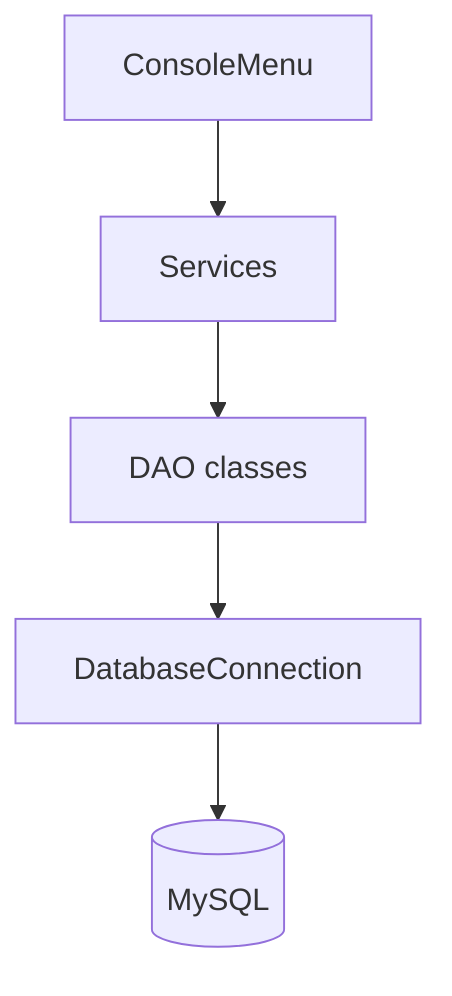
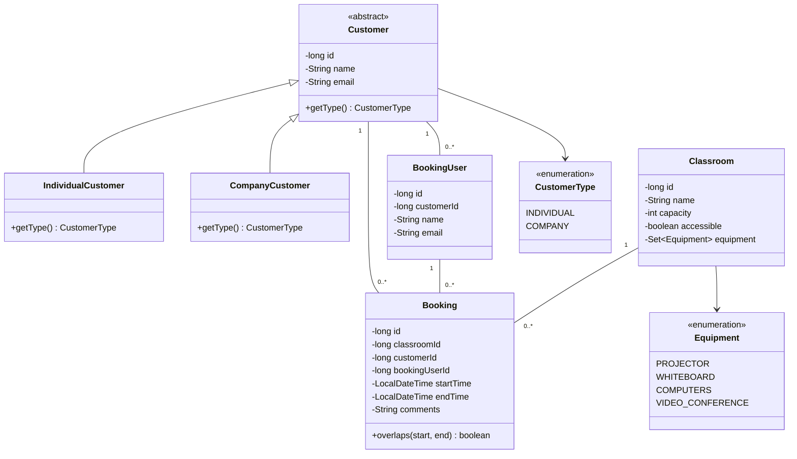
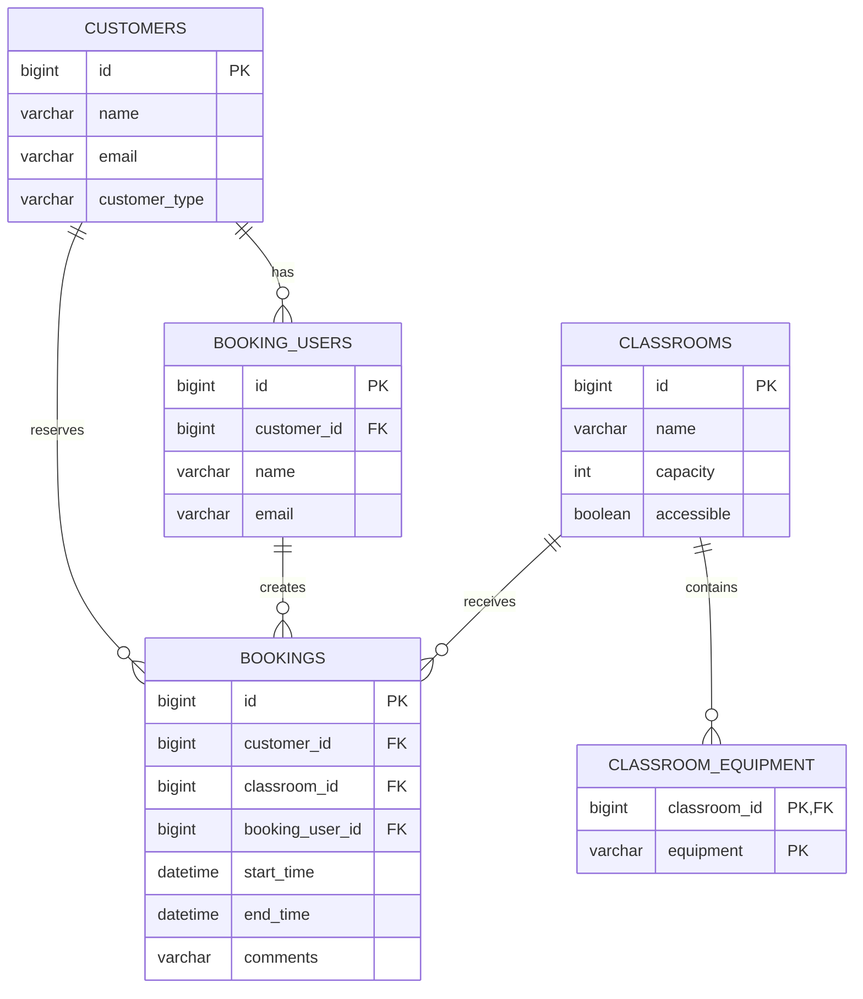

# Application and Database Design

## 1. Architecture

Use plain Java 25, Maven, MySQL and JDBC. Keep the application small: no web framework, ORM, separate controller or authentication system.



| Package | Responsibility |
| --- | --- |
| model | Customer, classroom, booking and related types |
| dao | SQL, prepared statements and JDBC mapping |
| service | Validation, filtering and business rules |
| ui | Console menus and user input |
| util | Database connection configuration |

Main creates and connects the objects. ConsoleMenu calls services, services call DAO classes, and DAOs use JDBC. Domain models are shared across layers.

## 2. UML class diagram



Customer defines common fields. Each subclass overrides getType(), demonstrating polymorphism. Both types share the customers table; JDBC maps the stored customer type to the correct subclass. Booking references the IDs of related records. Equipment uses a small predefined enum, and a Set prevents duplicate equipment.

## 3. Database design

Database: classroom_rental.



- Primary keys are generated for customers, booking users, classrooms and bookings.
- Classroom names are unique. Capacity must be positive. Equipment has a composite primary key (classroom_id, equipment).
- Use foreign keys to protect related records. The booking user must belong to the selected customer; enforce this in the service and with a composite foreign key referencing a unique (customer_id, id) pair in booking_users.
- Booking end must be after start; comments may be null. Use local date/time at minute precision.
- Seed 20 fictional classrooms and a few fictional customers and booking users.
- Never commit database passwords. Configure the database URL, username and password via environment variables.
- Index booking classroom and time columns and customer ID for lookup.

## 4. Supporting classes

| Class | Purpose |
| --- | --- |
| Main | Start the application and construct dependencies |
| ConsoleMenu | Display menus and read validated input |
| CustomerService | Register customers and their booking users |
| ClassroomService | Maintain classroom details and search for matching available rooms |
| BookingService | Validate and create bookings, cancel bookings and list reservations |
| CustomerDao | Persist customers and map their types |
| BookingUserDao | Persist booking users and look up users by customer |
| ClassroomDao | Read and update rooms and equipment |
| BookingDao | Query, insert and delete bookings |
| DatabaseConnection | Open JDBC connections using environment variables |

No generic DAO framework is needed. Add methods only when a workflow needs them.

## 5. Availability and booking rules

1. Validate requested start/end times and minimum capacity.
2. Read classrooms and conflicting classroom IDs from the database.
3. Use Java streams to filter capacity, required equipment, accessibility and conflicting IDs.
4. Sort suitable rooms by capacity and name.
5. Select a room, customer and booking user; enter optional comments.
6. Validate the selected room against the same requirements and verify customer/user relationship.
7. Save the reservation only after rechecking conflicts in a database transaction.

Two time ranges overlap if both conditions are true:

```java
existingStart.isBefore(requestedEnd)
    && existingEnd.isAfter(requestedStart)
```

Equivalent SQL condition (parameter order: classroom ID, requested end, requested start):

```sql
WHERE classroom_id = ?
  AND start_time < ?
  AND end_time > ?
```

A booking ending at 12:00 does not overlap one starting at 12:00. The same time range can be booked in a different classroom.

Availability results are not reservations. To avoid a concurrent double booking, BookingDao will use a transaction on one connection: lock the selected classroom row with SELECT FOR UPDATE, read conflicting bookings using a locking read, insert only if none exist, then commit; roll back on failure. All booking inserts must use this path. The console app is intended for a single facility, not a distributed booking service.

## 6. Console menu

1. Register customer
2. Register booking user
3. List classrooms
4. Update classroom
5. Search available classrooms
6. Create booking (search and select a suitable room)
7. View bookings by classroom
8. View bookings by customer
9. View upcoming bookings
10. Cancel booking
0. Exit

Cancellation is a small supporting feature to demonstrate SQL DELETE. Classroom updates demonstrate UPDATE, registration and booking demonstrate INSERT, and lists/search demonstrate SELECT. Keep the 20-room inventory fixed. Cancellation removes the selected booking; no audit/history workflow is required. No full login system: selecting a booking user records attribution, not authenticated identity.

## 7. Testing and interview

Test invalid dates, insufficient capacity, missing equipment, accessibility, overlapping and adjacent bookings, different rooms, customer/user mismatch, persistence and cancellation. Include focused JUnit tests and MySQL integration checks, then run a manual console demo.

Explain the flow: console -> service -> DAO -> MySQL. Show how the customer subclasses implement polymorphism, how streams filter rooms, how prepared statements bind values and why the overlap condition works.

This is the proposed implementation baseline. Update this document if the implementation changes. See [requirements](REQUIREMENTS.md).
